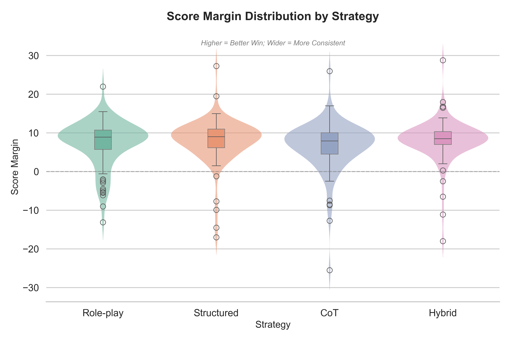
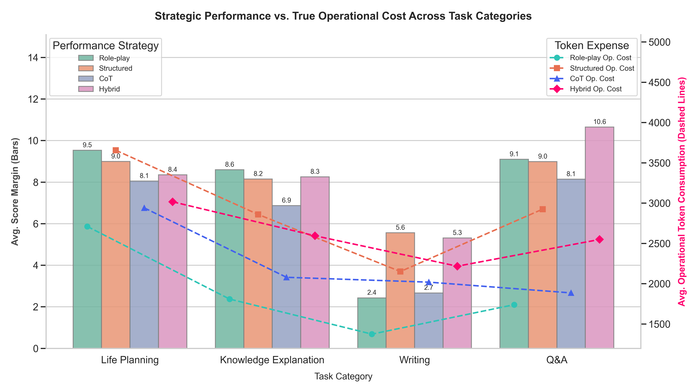
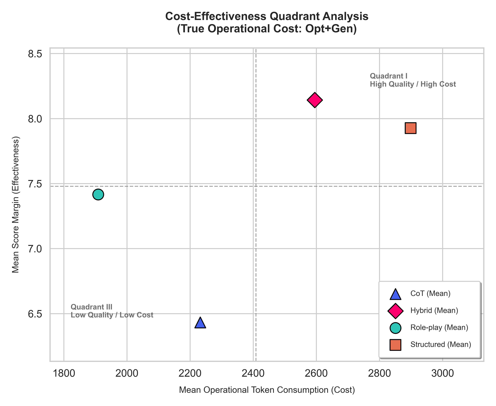

# AI Prompt Optimizer

[繁體中文](#繁體中文) · [English](#english)

## 繁體中文

**將使用者輸入轉化為更清楚、精確的提示詞。**

本專案為大學專題「AI 文字生成提示詞自動優化之研究」，以 Meta-Prompting 技術優化提示詞，並透過 AI 評審進行量化與實質評估，再進行優化成效分析。

網頁僅用來展示優化提示詞的流程與模型的不同輸出，其餘的實驗皆在後台進行。目標是降低提示工程的使用門檻，幫助使用者更清楚地向 LLM 表達需求，改善回覆品質。

### 功能

- 四種優化策略：角色扮演、結構化、思維鏈、混合策略。
- 分別選擇優化模型與生成模型。
- 選用同一生成模型依序回答兩版提示詞，並排比較效果。
- 支援中英文介面、長文展開、複製、Markdown 表格與數學公式。

### 系統流程

```text
使用者輸入 + 優化策略 → 優化模型 → 優化後提示詞
                                      ↓
                    原始提示詞 (使用者輸入) → *生成模型 → 原始回答 (* 相同生成模型)
                    優化提示詞 (經模型優化) → *生成模型 → 優化回答
                                                          ↓ (後臺進行)
                                                      三位評審評分、評語 → 量化分析優化成效
```

技術：Next.js、React、TypeScript、Tailwind CSS、LLM APIs

### 本地部署

以下以 Windows PowerShell 為例。

#### 1. 安裝必要工具

安裝 Git、Node.js 22.18 以上版本與 npm，確認終端能執行：

```powershell
git --version
node --version
npm --version
```

#### 2. 下載專案

在想存放專案的位置開啟終端：

```powershell
git clone https://github.com/Rex60309/ai-prompt-optimizer.git
cd ai-prompt-optimizer
```

#### 3. 安裝相依套件

```powershell
npm ci
```

此指令依 `package-lock.json` 安裝固定版本，首次執行需等待下載完成。

#### 4. 設定 API 金鑰

```powershell
Copy-Item .env.example .env.local
```

使用文字編輯器開啟 `.env.example` 並改名為 `.env.local`，再填入所需的金鑰：

```dotenv
GOOGLE_API_KEY=你的_Google_API_金鑰
GROQ_API_KEY=你的_Groq_API_金鑰
```

目前程式會讀取 `GOOGLE_API_KEY` 與 `GROQ_API_KEY`。(之後可能擴充其他供應商)

變數名稱需與後端讀取的名稱一致，並非所有 SDK 都會自動讀取上述命名。其他供應商的計費依其方案而定，不屬於目前 Demo 的免費模型配置。

- Google 金鑰可在 [Google AI Studio](https://aistudio.google.com/api-keys) 建立；Groq 金鑰可在 [Groq Console](https://console.groq.com/keys) 建立。
- 只使用一家供應商時，另一欄可留空；前台請選擇已設定金鑰的供應商模型。
- 目前預設模型為 Gemini 2.5 Flash-Lite；只設定 Groq 時，請將優化與生成模型都改為 Groq 選項。
- 使用免費方案帳戶，額度與模型可用性以供應商為準。免費額度不代表無限制呼叫，付費帳戶也不會因本系統而自動關閉計費。
- 金鑰由本機伺服器讀取，用於向供應商 API 發送請求；不要將真實金鑰上傳至 Git。修改環境檔後需重新啟動網站。

#### 5. 啟動開發環境

```powershell
npm run dev
```

瀏覽器開啟 [http://127.0.0.1:3100](http://127.0.0.1:3100)。終端需保持執行，按 `Ctrl + C` 可停止。網站預設僅供本機存取。

操作順序：選擇模型與策略 → 輸入提示詞 → 點選優化 → 複製優化提示詞。若想觀察成效，再點選 Generate，系統會依序生成原始與優化回答。

#### 6. 本地正式模式與檢查

正式模式需先建置：

```powershell
npm run build
npm start
```

開發檢查可分別執行：

```powershell
npm run format:check
npm run typecheck
npm run lint
npm test
```

常見問題：

| 狀況             | 處理方式                                                                   |
| ---------------- | -------------------------------------------------------------------------- |
| 缺少 API 金鑰    | 檢查 `.env.local` 名稱、金鑰欄位與所選模型，重新啟動網站。                 |
| 額度不足         | 等待供應商額度重設，或手動改選另一個已有金鑰的模型。                       |
| 埠號被占用或拒絕 | 停止占用程序，或執行 `npm run dev -- --port 3200`，再開啟對應網址。        |
| 回答達輸出上限   | 展開可看全部已收到文字，但無法補回模型未生成的部分；可縮小需求或分段提問。 |

### 實驗

#### 研究問題與評估流程

實驗關注三個問題：改寫能否提升回答品質、不同任務適合哪種策略，以及品質增益是否值得額外的 Token 用量。

實驗以 LMSYS-CHAT-1M 為題目來源，選取 100 筆提示詞，分成生活規劃、知識解說、寫作、疑問解答，各 25 題。每題分別以四種策略改寫，並用相同生成模型回答原始與優化提示詞。

| 策略     | 改寫重點                                 |
| -------- | ---------------------------------------- |
| 角色扮演 | 加入適合任務的角色與領域觀點。           |
| 結構化   | 將需求整理為任務、背景、限制與輸出格式。 |
| 思維鏈   | 加入分步分析與推理引導。                 |
| 混合     | 結合角色、結構與推理指引。               |

評審比較兩份回答，在內容完整度、需求符合度、結構清晰度、創意與洞察力、語氣風格五項各評 1–10 分，合計最高 50 分，並提供評語。報告流程在優化分數較低時，以回饋再次改寫，最多額外迭代兩次。

> **版本說明：** 實驗的優化模型為 GPT-5.2、生成模型為 GPT-4o-mini，評審為 GPT-5、Gemini-3.1-Flash-lite 與 Llama-3.3-70b-versatile。目前 Demo 僅用免費 API ，與實驗無關。

#### 結果分析

每個策略均有 100 筆測試 prompt；優化成效為「優化回答總分 − 原始回答總分」，勝／敗／平依總分正負判定。

| 策略     | 平均分數增益／50 分 | 勝／敗／平 |
| -------- | ------------------: | ---------- |
| 角色扮演 |              +7.404 | 86／14／0  |
| 結構化   |              +7.986 | 95／5／0   |
| 思維鏈   |              +6.559 | 89／10／1  |
| 混合     |              +8.143 | 96／4／0   |

四種策略均呈現正的平均增效。混合策略的平均得分提高題數最多，結構化位居第二。



圖中縱軸為勝分差，0 為原始與優化回答同分；負值代表優化退步。小提琴寬度代表該分數附近的資料密度，不直接代表策略更穩定。此圖可用來觀察分布、離群值與失敗案例。

#### 任務類別差異



長條對應左軸分數增益，虛線對應右軸 Token 用量。依原圖可觀察：

- **生活規劃與知識解說**：Role-play 的平均增益約為 9.5 與 8.6 分，且 Token 用量較低。
- **寫作**：Structured 約增加 5.6 分，Hybrid 約 5.3 分，兩者高於圖中的 Role-play 與 CoT，但各策略增益普遍低於其他任務。
- **疑問解答**：Hybrid 約增加 10.6 分，為此類別圖中最高。

這些結果支持進一步研究「依任務選策略」，不代表已驗證通用的選擇規則。但仍需要更多測試樣本與重複實驗。

#### 成本與品質的取捨



橫軸為優化與生成流程的平均 Token 用量，縱軸為平均分數增益，虛線為跨策略平均值。原圖中，Role-play 用量最低；Hybrid 與 Structured 增益較高，但也消耗更多 Token。這提示系統可依品質需求與資源預算選擇策略，而不是一律使用最複雜的模板。

### 未來展望

以下為後續研究與功能規劃，尚未完成實作。

1. **自動選擇優化策略**：延伸報告提出的語意分類方向，依任務、生成模型與預算推薦策略，並加入「保留原文」與「最小改寫」基準，驗證是否真的需要複雜改寫。
2. **提升評估可信度**：修正評分模板，並結合異質模型與人工盲評；依任務調整評分權重。
3. **跨模型與多語言驗證**：比較不同能力與供應商的生成模型，檢查策略排名是否改變；讓提示詞優化語言更完整對應使用者需求。
4. **多模態提示詞優化**：延伸研究圖像或影片生成的策略模板與評估方式，另建適合該模態的測試集。
5. **更順暢的使用流程**：加入串流顯示、取消生成、單側重試、提示詞版本比較與個人範本，並補上登入功能與共享額度管理。

---

## English

**Turn user input into clearer, more precise prompts.**

This project is the undergraduate capstone _A Study on Automatic Prompt Optimization for AI Text Generation_. It uses meta-prompting to optimize prompts, conducts quantitative and qualitative evaluation through AI judges, and then analyzes optimization effectiveness.

The web interface is used only to demonstrate the prompt optimization process and the different model outputs; all other experiments are conducted in the backend. The goal is to lower the barrier to prompt engineering, help users express their needs more clearly to LLMs, and improve response quality.

### Features

- Four optimization strategies: role-play, structured prompting, chain of thought, and hybrid prompting.
- Separate selection of optimizer and generator models.
- Optional sequential generation with the same model to compare both prompt versions side by side.
- Chinese and English interfaces, expandable content, copying, Markdown tables, and mathematical notation.

### System Workflow

```text
User input + optimization strategy → Optimizer model → Optimized prompt
                                                        ↓
                    Original prompt (user input) → *Generator model → Original answer (* Same generator model)
                    Optimized prompt (rewritten by the model) → *Generator model → Optimized answer
                                                                                    ↓ (In the backend)
                                                        Scores and comments from three judges → Quantitative analysis of optimization effectiveness
```

Technologies: Next.js, React, TypeScript, Tailwind CSS, LLM APIs.

### Local Deployment

The following steps use Windows PowerShell.

#### 1. Install Prerequisites

Install Git, Node.js 22.18 or later, and npm. Verify that these commands work:

```powershell
git --version
node --version
npm --version
```

#### 2. Download the Project

Open a terminal in the directory where you want to store the project:

```powershell
git clone https://github.com/Rex60309/ai-prompt-optimizer.git
cd ai-prompt-optimizer
```

#### 3. Install Dependencies

```powershell
npm ci
```

This command installs fixed versions according to `package-lock.json`. On the first run, wait for the downloads to complete.

#### 4. Configure API Keys

```powershell
Copy-Item .env.example .env.local
```

Open `.env.example` in a text editor, rename it to `.env.local`, and enter the keys you need:

```dotenv
GOOGLE_API_KEY=your_google_api_key
GROQ_API_KEY=your_groq_api_key
```

The application currently reads `GOOGLE_API_KEY` and `GROQ_API_KEY`. (Other providers may be added in the future.)

Variable names must match those read by the backend; not every SDK automatically reads these names. Other providers follow their own billing plans and are outside the demo's current free-tier model configuration.

- Create Google keys in [Google AI Studio](https://aistudio.google.com/api-keys) and Groq keys in [Groq Console](https://console.groq.com/keys).
- If you use only one provider, leave the other field blank and select models from the configured provider in the interface.
- Gemini 2.5 Flash-Lite is the default. If only Groq is configured, switch both the optimizer and generator to Groq models.
- Use free-tier accounts; quotas and model availability are determined by the provider. Free access is not unlimited, and this application does not disable billing on paid accounts.
- Keys are read by the local server to send requests to provider APIs. Never upload real keys to Git. Restart the application after changing environment files.

#### 5. Start the Development Server

```powershell
npm run dev
```

Open [http://127.0.0.1:3100](http://127.0.0.1:3100). Keep the terminal running; press `Ctrl + C` to stop the server. By default, the application is accessible only on your machine.

Select models and a strategy → enter a prompt → optimize → copy the optimized prompt. To inspect its effects, select Generate to produce the original and optimized answers sequentially.

#### 6. Local Production Mode and Checks

Build before starting production mode:

```powershell
npm run build
npm start
```

Run development checks separately:

```powershell
npm run format:check
npm run typecheck
npm run lint
npm test
```

Common issues:

| Issue                             | Resolution                                                                                                                                |
| --------------------------------- | ----------------------------------------------------------------------------------------------------------------------------------------- |
| Missing API key                   | Check the `.env.local` filename, key fields, and selected model, then restart the server.                                                 |
| Quota exceeded                    | Wait for the provider's quota reset or manually select another model with a configured key.                                               |
| Port unavailable or access denied | Stop the process using the port, or run `npm run dev -- --port 3200` and open the corresponding URL.                                      |
| Output limit reached              | Expand to read all received text. Text not generated by the model cannot be recovered; narrow the request or split it into smaller tasks. |

### Experiments

#### Research Questions and Evaluation Procedure

The experiments investigate whether rewriting improves response quality, which strategies suit different tasks, and whether quality gains justify additional token usage.

The experiment uses LMSYS-CHAT-1M as its source and selects 100 prompts: 25 each for life planning, knowledge explanation, writing, and question answering. Each prompt is rewritten using the four strategies, and the same generator model answers the original and optimized prompts.

| Strategy   | Rewriting focus                                                           |
| ---------- | ------------------------------------------------------------------------- |
| Role-play  | Add task-appropriate roles and domain perspectives.                       |
| Structured | Organize requirements into task, context, constraints, and output format. |
| CoT        | Add step-by-step analysis and reasoning guidance.                         |
| Hybrid     | Combine role, structure, and reasoning instructions.                      |

Judges compare both answers on completeness, requirement alignment, structural clarity, creativity and insight, and tone and style. Each criterion receives 1–10 points, totaling up to 50, with written feedback. In the reported workflow, a lower optimized score triggers another rewrite based on feedback, with at most two additional iterations.

> **Version note:** The experiment uses GPT-5.2 as the optimizer, GPT-4o-mini as the generator, and GPT-5, Gemini-3.1-Flash-lite, and Llama-3.3-70b-versatile as judges. The current demo uses only free APIs and is separate from the experiment.

#### Results Analysis

Each strategy is tested on 100 prompts. Optimization effectiveness is calculated as the optimized answer total minus the original answer total; wins, losses, and ties are determined by whether the score difference is positive, negative, or zero.

| Strategy   | Mean score gain / 50 | Wins / losses / ties |
| ---------- | -------------------: | -------------------- |
| Role-play  |               +7.404 | 86 / 14 / 0          |
| Structured |               +7.986 | 95 / 5 / 0           |
| CoT        |               +6.559 | 89 / 10 / 1          |
| Hybrid     |               +8.143 | 96 / 4 / 0           |

All four strategies show positive mean gains. Hybrid has the most prompts with increased scores, followed by Structured.


The vertical axis shows the score margin; zero means equal original and optimized scores, while negative values indicate regression. Violin width represents local data density, not stability directly. The figure can be used to inspect distributions, outliers, and failure cases.

#### Differences Across Task Categories


Bars show score gains on the left axis; dashed lines show token usage on the right. The original figure suggests:

- **Life planning and knowledge explanation:** Role-play gains approximately 9.5 and 8.6 points, respectively, with lower token usage.
- **Writing:** Structured gains approximately 5.6 points and Hybrid 5.3, above Role-play and CoT in the figure. Gains across strategies are generally lower than for other tasks.
- **Question answering:** Hybrid gains approximately 10.6 points, the highest in that category.

These results support further research into task-based strategy selection, rather than establish a validated universal selection rule. More test samples and repeated experiments are still needed.

#### Cost–Quality Trade-offs


The horizontal axis shows mean tokens used for optimization and generation; the vertical axis shows mean score gain. Dashed lines indicate cross-strategy means. Role-play uses the fewest tokens in the original figure, while Hybrid and Structured achieve higher gains at greater token usage. This motivates choosing strategies according to quality requirements and resource budgets rather than always applying the most complex template.

### Future Outlook

The following research directions and features are planned for future work and have not yet been implemented.

1. **Automatic strategy selection:** Extend the semantic classification direction proposed in the report to recommend strategies based on the task, generator model, and budget. Add unchanged and minimally rewritten prompts as baselines to test whether complex rewriting is necessary.
2. **Improving evaluation reliability:** Revise the scoring rubric and combine heterogeneous models with human blind review; adjust evaluation weights by task.
3. **Cross-model and multilingual validation:** Compare generator models with different capabilities and providers to examine whether strategy rankings change, and better align the language of prompt optimization with user requirements.
4. **Multimodal prompt optimization:** Extend the research to strategy templates and evaluation methods for image or video generation, with test sets suited to each modality.
5. **A smoother user workflow:** Add streaming output, cancellation, single-answer retries, prompt version comparison, and personal templates, together with login functionality and shared quota management.
